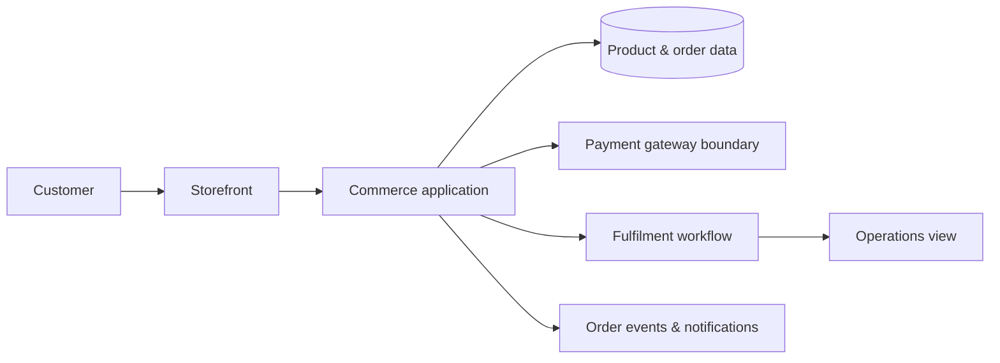

# Architecture notes

## The design question

How can a small commerce product offer a straightforward customer experience while keeping catalogue, order, payment, and fulfilment concerns distinct? The public pattern below shows a deliberately high-level answer.

## Engineering decisions illustrated

1. **Keep the journey coherent.** Catalogue, basket, checkout, and confirmation are part of one customer workflow, even when their responsibilities are separated behind the scenes.
2. **Make state explicit.** An order moves through named states such as pending, authorised, and ready to fulfil; this gives users and operations teams a shared language.
3. **Treat payments as a boundary.** A storefront should request a payment outcome through a provider interface, rather than place sensitive card handling in application code.
4. **Design for operations.** Order status, fulfilment hand-off, and notifications need to be understandable after the checkout screen has closed.

## Exclusions

No real product catalogue, order workflow, payment adapter, gateway credential, pricing rule, tax rule, customer data, database model, endpoint, infrastructure configuration, or deployment setup is reproduced here. The diagram is conceptual.
